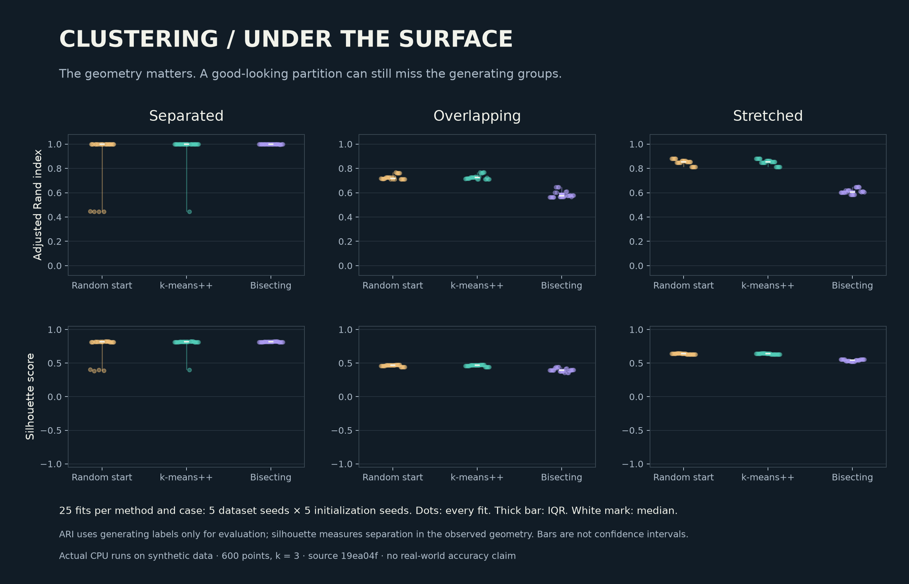
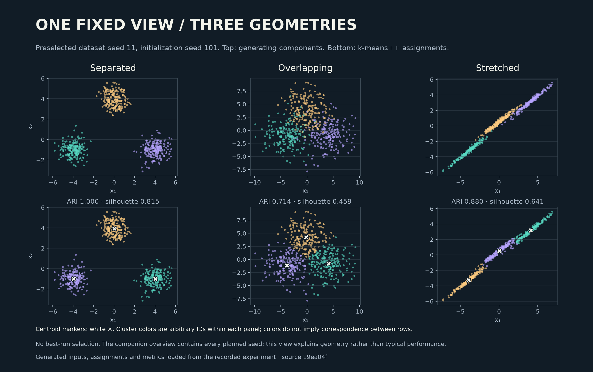

# Clustering Study

**How much do initialization and geometry change the clusters we find?**

An independent NumPy study of random-start k-means, vanilla k-means++ and
bisecting k-means. It records every planned seed, checks results against numerical
invariants and identical-start library runs, and produces figures directly from
saved evidence. All datasets are generated locally; no downloads or paid compute
are needed to run the experiment after installing the dependencies.



Each panel contains 25 actual fits per method: five dataset seeds × five
initialization seeds. Dots show every fit; thick bars show the interquartile range,
white marks the median, and thin lines the minimum–maximum range. These are
**synthetic-data results**, with dependent repetitions—not confidence intervals or
real-world accuracy estimates.

## What the recorded run shows

| Geometry | Random start: median ARI | k-means++: median ARI | Bisecting: median ARI |
|---|---:|---:|---:|
| Separated | 1.000 | 1.000 | 1.000 |
| Overlapping | 0.718 | 0.727 | 0.574 |
| Stretched | 0.852 | 0.852 | 0.605 |

A median alone hides initialization failures: on separated data, some flat runs
reach a poor local solution despite a median ARI of 1. The overlapping and
stretched cases also show that a coherent geometric partition need not recover
the generating groups. These are observations about this fixed experiment; they
do not establish a universally best clustering method.

See [methods and limits](docs/methods.md), [validation status](docs/validation.md),
and the [complete result record](results/published/study.json).
All 225 fits converged; all 150 identical-start library checks matched the
custom partitions. A second full run reproduced every numerical field exactly
in the same environment; timings are excluded from that equality claim.

## Quick start

Tested locally with Python 3.11. Use a separate environment:

```sh
python3 -m venv .venv
source .venv/bin/activate
python -m pip install -r requirements.txt
LOKY_MAX_CPU_COUNT=1 MPLCONFIGDIR=/tmp/clustering-mpl python -m pytest --rootdir=. -q
python - <<'PY'
from clustering_study.core import kmeans
r = kmeans([[0.], [2.], [8.], [10.]], 2, initial=[[0.], [10.]])
print(r.centers.ravel().tolist(), r.inertia, r.converged)
PY
```

Expected: `[1.0, 9.0] 4.0 True`. The numerical core needs NumPy; the full study
uses the pinned evaluation and plotting dependencies in `requirements.txt`.

## Reproduce the study and figures

Run from this repository's root, after committing your intended source changes:

```sh
LOKY_MAX_CPU_COUNT=1 MPLCONFIGDIR=/tmp/clustering-mpl python -m clustering_study.experiment run results/my-study
LOKY_MAX_CPU_COUNT=1 MPLCONFIGDIR=/tmp/clustering-mpl python -m clustering_study.experiment verify results/my-study
LOKY_MAX_CPU_COUNT=1 MPLCONFIGDIR=/tmp/clustering-mpl python scripts/plot_results.py results/my-study figures-my-study
```

To compare a second full run, use
`python scripts/compare_runs.py results/my-study results/my-study-repeat`.
The comparison verifies both records, then checks inputs and every numerical
fit field while excluding elapsed times.

Both output directories must be new. A Git checkout is required for source
provenance; an extracted source ZIP alone cannot supply the commit identity.
The runner stores whether the checkout was clean. Only a clean run should be
curated for publication. Verification reruns the algorithms and library checks,
checks all source/input hashes, recomputes metrics and rejects incomplete evidence.
It does not authenticate elapsed timings or prove that a record's author is honest.

The experiment runs 225 custom fits and 150 identical-start scikit-learn reference
fits. Verification replays them. Library thread pools are limited to one; no cloud
or GPU calls occur. The default study uses 600 points and k=3.



This illustration always uses the first declared dataset and initialization seeds
(11 and 101). It is not the best run selected after examining results. Colors are
arbitrary cluster IDs within each panel; white markers show learned centroids.

## Numerical contract

`kmeans(X, k, seed=0, init='plus', initial=None, max_iter=300)` returns centres,
nearest-centre labels, inertia, iteration count, convergence and update history.
`bisect(X, k, seed=0, max_iter=300)` returns hierarchical leaf membership;
its labels need not be globally nearest to the final leaf centres.

Inputs must be finite real matrices with 1–10,000 rows, 1–64 features and
1 ≤ k ≤ min(64, distinct observations). Coordinates must be zero or have
magnitude between 1e-100 and 1e6. Unsupported scales fail explicitly to avoid
squared-distance underflow. Seeds are integers 0…2³²−1; iteration limits 1…10,000.
Booleans are not accepted as integer parameters. Inputs and global random state
are preserved. See [the precise algorithm](docs/methods.md).

## Validation and scope

Local tests cover analytical expectations, library agreement, duplicates, empty
clusters, invalid inputs, iteration exhaustion, reproducibility, saved-record
corruption and interrupted completion. The Linux workflow is prepared; execution
on GitHub has **not yet been performed**. No Linux-pass badge or release claim is
made until that run exists.

This educational implementation is designed for small reproducible studies. It
is not a scalable production estimator, a GPU benchmark, or a model trained on
real-world data. Silhouette evaluation uses pairwise distances; the study runner
therefore caps datasets at 2,000 points.

## Ownership and contribution

[MIT license](LICENSE). The algorithms and runner are independently written from
mathematical definitions. Original coursework, assignment PDFs, provided datasets
and recovered supercomputer archives are not copied or modified. Library
implementations are used as dependencies and references under their own licenses.
See [provenance](docs/provenance.md) and [contributing](CONTRIBUTING.md).
